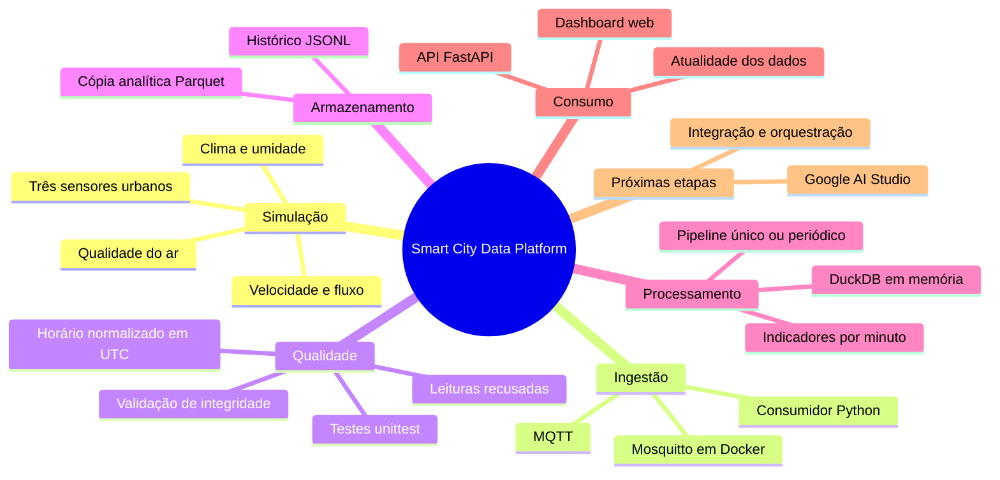
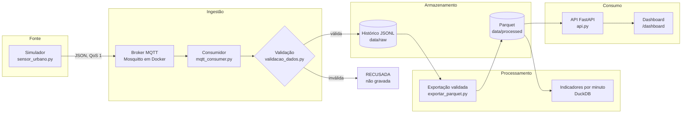
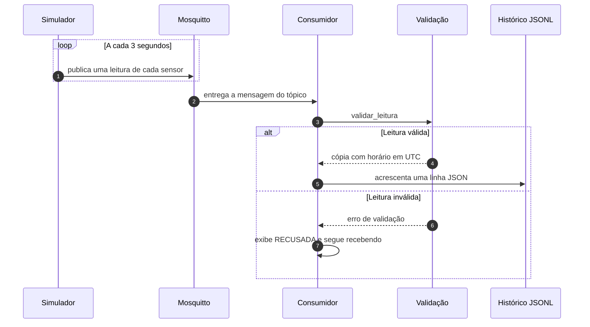
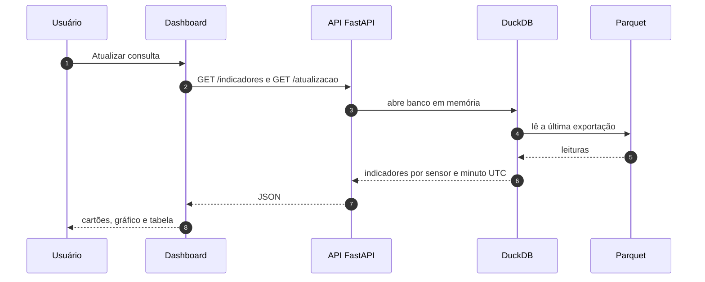
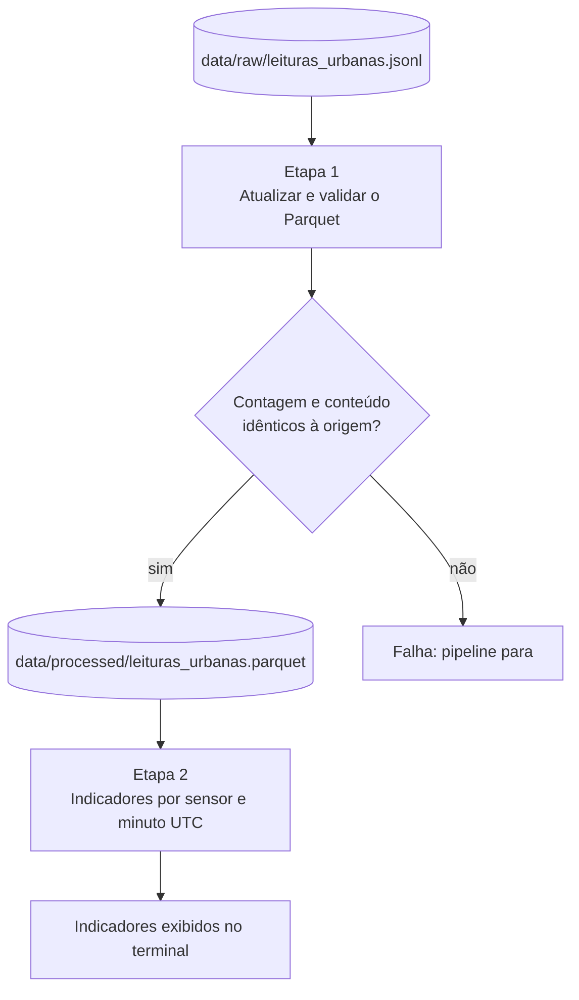
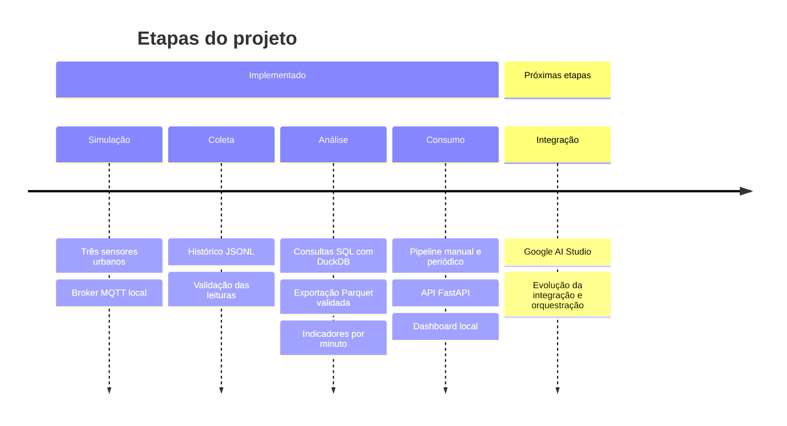

# Smart City Data Platform

<p align="center">
  
  
  
  
</p>
<p align="center">
  
  
  
  
  
  
</p>
<p align="center">
  
  
  
  
  
  
</p>

<p align="center">
  Plataforma de dados urbanos para <b>simulação, integração, processamento e análise</b> de informações de
  cidades inteligentes — de sensores simulados via MQTT até uma API e um dashboard local.
</p>

<p align="center">
  <a href="#-visão-geral">Visão Geral</a> •
  <a href="#-mapa-do-projeto">Mapa</a> •
  <a href="#-fluxo-de-dados">Fluxo de dados</a> •
  <a href="#-validação-das-leituras">Validação</a> •
  <a href="#-pipeline-analítico">Pipeline</a> •
  <a href="#-api-local">API</a> •
  <a href="#-dashboard-local">Dashboard</a> •
  <a href="#-roteiro">Roteiro</a>
</p>

---

## 📌 Visão Geral

O projeto é desenvolvido **por etapas**, com **execução local** e **dados simulados**, sem necessidade de
hardware físico. Três sensores urbanos fictícios publicam leituras de clima, qualidade do ar e mobilidade;
um consumidor valida e grava essas leituras; um pipeline gera uma cópia analítica em Parquet; e uma API
FastAPI serve os indicadores para um dashboard web.

| Sensor | Local | Velocidade simulada | Fluxo simulado |
|---|---|---|---|
| `URB-001` | Centro | 10 a 35 km/h | 50 a 100 veículos/min |
| `URB-002` | Bairro residencial | 20 a 45 km/h | 5 a 30 veículos/min |
| `URB-003` | Avenida principal | 35 a 65 km/h | 30 a 80 veículos/min |

<details>
<summary><b>📨 Formato de uma leitura</b> (clique para expandir)</summary>

Cada mensagem publicada no tópico `smartcity/sensores/urbanos` (QoS 1) é um JSON como este
(valores ilustrativos):

```json
{
  "sensor_id": "URB-001",
  "cidade": "Cidade Simulada",
  "timestamp": "2026-10-20T15:00:00+00:00",
  "temperatura_c": 24.31,
  "umidade_percentual": 61.2,
  "pm25_ug_m3": 18.75,
  "velocidade_media_kmh": 22.4,
  "veiculos_por_minuto": 74
}
```

| Campo | Unidade | Faixa gerada pelo simulador |
|---|---|---|
| `temperatura_c` | °C | 18 a 35 |
| `umidade_percentual` | % | 35 a 90 |
| `pm25_ug_m3` | µg/m³ | 5 a 80 |
| `velocidade_media_kmh` | km/h | conforme o sensor (tabela acima) |
| `veiculos_por_minuto` | veículos/min (inteiro) | conforme o sensor (tabela acima) |

</details>

### 🎯 Objetivos

| Objetivo | Situação |
|---|---|
| Simular dados de mobilidade urbana e meio ambiente | ✅ Implementado |
| Implementar comunicação com MQTT | ✅ Implementado |
| Armazenar dados analíticos em Parquet | ✅ Implementado |
| Consultar dados com DuckDB | ✅ Implementado |
| Explorar streaming de eventos com Apache Kafka | 🕒 Planejado |
| Integrar bancos SQL e NoSQL | 🕒 Planejado |
| Processar dados com Apache Spark | 🕒 Planejado |
| Automatizar pipelines com Apache Airflow | 🕒 Planejado |
| Desenvolver um dashboard com Google AI Studio | 🕒 Planejado (há um dashboard web local já funcionando) |

## 🧠 Mapa do projeto



## 🔄 Fluxo de dados



<details>
<summary><b>🔁 Sequência: do sensor ao arquivo</b></summary>



</details>

<details>
<summary><b>🔁 Sequência: do Parquet ao dashboard</b></summary>



</details>

## 🔒 Validação das leituras

Antes de salvar, o consumidor verifica cada mensagem. As regras ficam em
[`src/validacao_dados.py`](src/validacao_dados.py) e são cobertas por
[`tests/test_validacao_dados.py`](tests/test_validacao_dados.py).

| Regra | Campos |
|---|---|
| Campos obrigatórios presentes | `sensor_id`, `timestamp` e as cinco métricas |
| Números finitos (sem `NaN`, infinito ou booleano) | todas as métricas |
| Entre 0 e 100 % | `umidade_percentual` |
| Não negativos | `pm25_ug_m3`, `velocidade_media_kmh` |
| Inteiro não negativo | `veiculos_por_minuto` |
| Data ISO 8601 **com fuso horário** | `timestamp` (normalizado em UTC) |

- Leituras inválidas exibem `[RECUSADA]` no terminal e **não são gravadas**; o consumidor segue
  recebendo mensagens.
- O histórico já salvo é preservado, sem revisão retroativa nesta etapa.

> [!IMPORTANT]
> As regras de integridade **não são** as faixas de cores do dashboard: uma medição fora da faixa
> "boa" pode ser perfeitamente válida e deve continuar sendo analisada.

## 📦 Pipeline analítico

A partir das leituras salvas em `data/raw/leituras_urbanas.jsonl`:



- Cada execução atualiza a **cópia Parquet completa**; o JSONL original é preservado.
- Se uma etapa falhar, o fluxo para.
- Pode rodar uma única vez ou em modo contínuo; ele **não** inicia a coleta MQTT.

### Atualização contínua

No modo contínuo, o pipeline executa um ciclo completo, espera o intervalo definido e repete, **sem sobrepor ciclos** (o intervalo
mínimo aceito é de 3 segundos). Em caso de erro, interrompe e exibe a falha.

> [!NOTE]
> Há atraso de coleta, processamento e consulta: a atualização é **periódica, não instantânea**.

<details>
<summary><b>💡 Parquet e DuckDB neste projeto</b></summary>

- **Parquet** é o formato de armazenamento por colunas usado na cópia analítica.
- **DuckDB** é o banco analítico executado dentro do Python para ler os arquivos, exportar Parquet e
  calcular indicadores com SQL.
- Neste projeto, as tabelas de trabalho do DuckDB ficam **em memória**; os arquivos JSONL e Parquet
  permanecem no disco.
- A exportação grava primeiro um arquivo temporário, confere registro a registro (incluindo duplicatas)
  e só então substitui a exportação anterior.

</details>

## 🌐 API local

API REST em **FastAPI**, com documentação interativa gerada automaticamente.

| Método | Rota | Parâmetros | Retorno |
|---|---|---|---|
| `GET` | `/` | — | Informações do projeto e link para a documentação |
| `GET` | `/sensores` | — | Sensores e quantidade de leituras |
| `GET` | `/indicadores` | `sensor_id` (opcional), `limite` (1 a 1000, padrão 100), `minutos` (opcional, 1 a 1440) | Indicadores por sensor e minuto UTC, mais recentes primeiro |
| `GET` | `/atualizacao` | `sensor_id` (opcional) | Última leitura exportada, idade e estado da atualidade |
| `GET` | `/dashboard` | — | Página do dashboard local |

- Horários em **UTC**.
- As consultas leem a **última exportação Parquet**.
- Sem o arquivo Parquet, a API responde `503`.

## 📊 Dashboard local

Página web servida pela própria API.

| Recurso | Descrição |
|---|---|
| Filtro por sensor | Todos os sensores ou um ponto específico |
| Filtro **Período** | Todo o histórico, últimos 15 minutos, última hora ou últimas 24 horas |
| Cartões de médias | Temperatura, umidade, PM2.5 e velocidade, com cor e rótulo |
| Gráfico | Temperatura média por minuto e sensor |
| Tabela | Leituras consolidadas por minuto UTC, até 1.000 grupos mais recentes |
| **Atualidade dos dados** | Idade da última leitura exportada |
| **Atualizar consulta** | Consulta novamente a exportação mais recente |

<details>
<summary><b>🔍 Detalhes de cada recurso</b></summary>

**Médias.** Os cartões usam médias ponderadas pela quantidade de leituras de cada grupo — aproximadas,
pois os grupos já estão arredondados.

**Período.** As janelas são relativas ao horário atual do servidor e aplicadas às leituras **antes** de
calcular médias e agrupamentos. Dados antigos podem não aparecer nas janelas recentes; selecione todo o
histórico para consultá-los. Na API, corresponde ao parâmetro `minutos` (1 a 1440) de `/indicadores`.

**Atualidade dos dados.** Mostra a última leitura exportada do sensor selecionado (ou a mais recente entre
todos), independentemente do filtro de período. O horário é exibido em São Paulo, e a idade corresponde ao
instante da consulta. Na API, corresponde à rota `/atualizacao` (com `sensor_id` opcional).

| Estado | Condição |
|---|---|
| Dados recentes | Última leitura com até 60 segundos |
| Dados sem atualização | Última leitura com mais de 60 segundos |
| Sem leituras | Aviso específico |
| Horário futuro | Aviso específico |

Esse indicador mede a atualidade do **Parquet**, não confirma a saúde dos serviços MQTT.

</details>

> [!TIP]
> A opção **Atualizar consulta automaticamente a cada 10 segundos** repete as consultas enquanto a página
> estiver aberta. Ela começa **desligada** e pode ser desmarcada a qualquer momento.

### 🎨 Como interpretar as cores

Os cartões exibem **Bom** (verde), **Ameno / atenção** (amarelo) e **Ruim** (vermelho); a seção abaixo
dos cartões detalha os intervalos. Sem dados, os cartões permanecem neutros.

| Indicador | 🟢 Bom | 🟡 Ameno / atenção | 🔴 Ruim |
|---|---|---|---|
| Temperatura (°C) | 18 a 26 | 12 a menos de 18; acima de 26 até 32 | abaixo de 12 ou acima de 32 |
| Umidade (%) | 40 a 60 | 30 a menos de 40; acima de 60 até 70 | abaixo de 30 ou acima de 70 |
| PM2.5 (µg/m³) | até 15 | acima de 15 até 35 | acima de 35 |
| Velocidade / fluidez (km/h) | 30 a 60 | 15 a menos de 30; acima de 60 até 70 | abaixo de 15 ou acima de 70 |

> [!NOTE]
> As faixas são **ilustrativas do projeto**, sem equivalência com limites oficiais de saúde ou trânsito.
> Na velocidade, representam apenas fluidez simulada. Os critérios ficam em
> [`src/web/index.html`](src/web/index.html), no objeto `criterios`.

## 🧰 Tecnologias

**Implementadas**

| Tecnologia | Aplicação no projeto |
|---|---|
| Python | Simulador, consumidor, validação, pipeline e API. |
| MQTT (`paho-mqtt`) | Publicação e assinatura das leituras dos sensores. |
| Eclipse Mosquitto | Broker MQTT local, executado em Docker. |
| Docker Compose | Inicialização do broker com um único comando. |
| JSONL | Histórico bruto das leituras válidas. |
| DuckDB | Consultas SQL, exportação Parquet e cálculo de indicadores. |
| Apache Parquet | Cópia analítica por colunas (compressão snappy). |
| FastAPI + Uvicorn | API local de leitura dos indicadores. |
| HTML + JavaScript | Dashboard web servido pela própria API. |
| unittest | Testes das regras de validação. |

**Planejadas** (citadas nos objetivos, ainda não implementadas)

| Tecnologia | Uso previsto |
|---|---|
| Apache Kafka | Streaming de eventos |
| MongoDB | Banco NoSQL |
| PostgreSQL + PostGIS | Banco SQL e dados geoespaciais |
| Apache Spark | Processamento de dados |
| Apache Airflow | Orquestração de pipelines |
| Google AI Studio | Dashboard |

## 📁 Estrutura do Repositório

```text
SmartCityDataPlatform/
├── simulators/
│   └── sensor_urbano.py         # simulador dos três sensores (publica via MQTT)
├── src/
│   ├── mqtt_consumer.py         # consumidor MQTT: valida e grava o JSONL
│   ├── validacao_dados.py       # regras de integridade das leituras
│   ├── exportar_parquet.py      # JSONL → Parquet, com conferência dos registros
│   ├── indicadores_por_minuto.py  # agrupamento por sensor e minuto UTC
│   ├── pipeline.py              # executa as etapas uma vez ou em ciclos
│   ├── api.py                   # API FastAPI e rota do dashboard
│   ├── consultar_sql.py         # consultas SQL sobre o JSONL
│   ├── analisar_dados.py        # médias do histórico
│   ├── main.py                  # verificação do ambiente
│   └── web/index.html           # dashboard local (critérios de cores)
├── tests/
│   └── test_validacao_dados.py  # testes da validação e do consumidor
├── docker/mosquitto/config/     # configuração do broker
├── data/                        # raw/ e processed/ — gerados localmente, NÃO versionados
├── docker-compose.yml           # serviço Mosquitto
├── requirements.txt             # paho-mqtt, duckdb, fastapi, uvicorn
├── .env.example                 # modelo de variáveis locais
└── README.md
```

## 🧭 Roteiro



- [x] Simulação de três sensores
- [x] MQTT local (Mosquitto em Docker)
- [x] Histórico JSONL com validação das leituras
- [x] Consultas SQL com DuckDB
- [x] Exportação Parquet validada
- [x] Indicadores por minuto
- [x] Pipeline manual (execução única e periódica)
- [x] API FastAPI
- [x] Dashboard local integrado
- [ ] Integração com Google AI Studio
- [ ] Evolução da integração e orquestração de dados (Kafka, bancos SQL e NoSQL, Spark, Airflow)

---

<p align="center">
  <b>Projeto de engenharia de dados aplicado a cidades inteligentes, cobrindo simulação, ingestão,
  validação, armazenamento analítico e visualização — tudo em ambiente local.</b>
</p>
